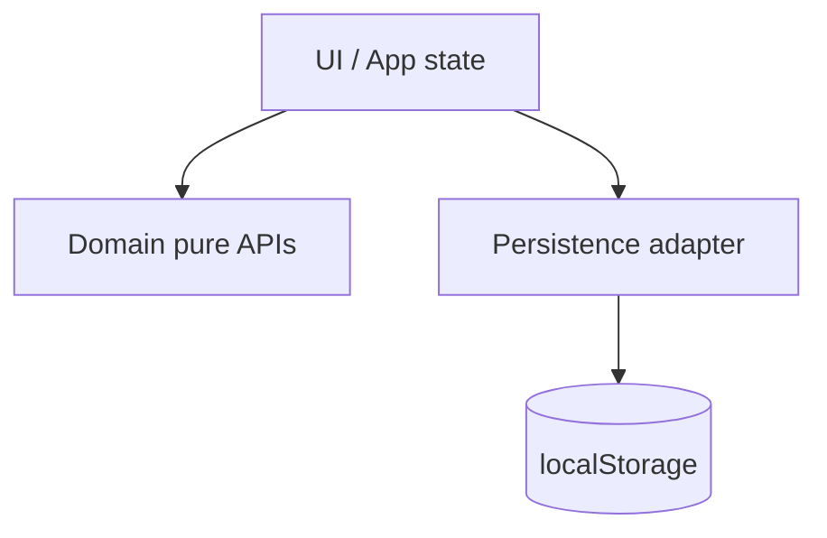
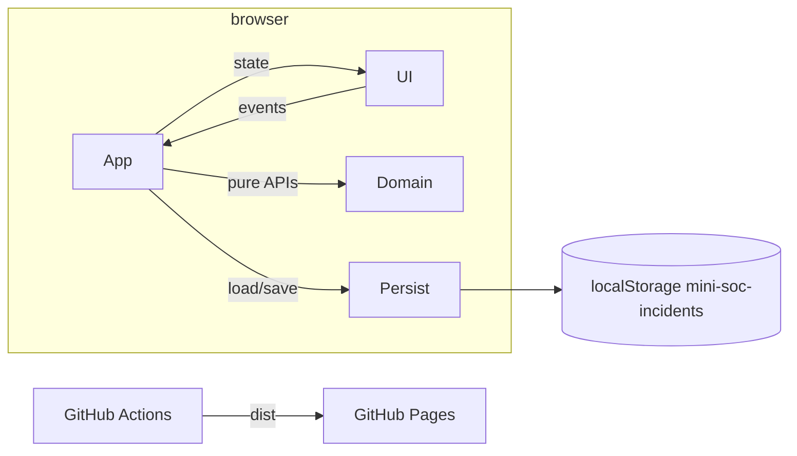

# Architecture Spine — Mini SOC Incident Tracker

## Design Paradigm

**Layered SPA** (client-only):

| Layer | Maps to | May depend on |
| --- | --- | --- |
| UI | `src/components/`, `src/App.tsx` | domain |
| Domain | `src/domain/` | nothing outside domain (pure helpers + types) |
| Persistence | `src/persistence/` | `Incident` type from domain only; browser `localStorage` |



## Invariants & Rules

### AD-1 — Official Vite react-ts starter `[ADOPTED]`

- **Binds:** tooling, app bootstrap
- **Prevents:** hand-rolled Vite/TS configs that diverge from a known baseline
- **Rule:** Scaffold with `npm create vite@latest . -- --template react-ts`. Keep template scripts (`dev` / `build` = `tsc -b && vite build` / `lint`). Stack seed pins match published create-vite@9.3.4 `react-ts` template; after scaffold, code owns lockfile versions.

### AD-2 — Layered dependency direction

- **Binds:** all modules
- **Prevents:** domain touching storage; persistence importing React; UI bypassing domain for create/status rules
- **Rule:** UI may import domain and persistence. Domain imports neither persistence nor React. Persistence imports only domain types (no React).

### AD-3 — Pure domain + single React collection owner `[ADOPTED]`

- **Binds:** FR-1, FR-3, FR-5
- **Prevents:** dual in-memory Incident lists (module singleton + React state)
- **Rule:** **Mode P:** Domain functions are pure (`createIncident`, `setIncidentStatus` take/return `Incident[]`). The authoritative collection lives only in React state in `src/App.tsx` (or one designated parent). Exactly one domain file (`src/domain/incidents.ts`) implements those mutations; other domain files are types/helpers only with no writable Incident array. Leaf components must not call domain mutations directly — only through App (or one App-owned hook).

### AD-4 — Persistence envelope and save path `[ADOPTED]`

- **Binds:** FR-5
- **Prevents:** wrapper-shape clash; forgotten saves; multiple keys
- **Rule:** Key is exactly `mini-soc-incidents`. Value is a **JSON array** of Incidents (no wrapper object). Persistence imports `Incident` from `domain/types.ts` only — no parallel stored type. On boot, App loads once via the adapter. After every successful create/status mutation, App saves the new array via the same adapter. On parse failure, non-array root, or `localStorage` throw: treat as `[]` (optionally `console.warn` once). Invalid elements on load are dropped (not partially normalized with silent defaults).

### AD-5 — Incident record shape `[ADOPTED]`

- **Binds:** FR-1..FR-5, shared data
- **Prevents:** incompatible field names/types across UI and storage
- **Rule:** Every Incident is exactly `{ id: string, title: string, severity: 'Low'|'Medium'|'High', status: 'Open'|'Resolved', createdAt: string }` (`createdAt` = ISO-8601 UTC). Create sets `status: 'Open'`, `id = crypto.randomUUID()`, `createdAt = new Date().toISOString()`. Save writes only these keys. No load-time defaulting of missing fields — invalid rows are dropped (AD-4).

### AD-6 — Filters are derived UI state `[ADOPTED]`

- **Binds:** FR-4
- **Prevents:** persisting filters; ambiguous AND vs OR
- **Rule:** Severity and Status filter selections live in UI state only (default both `All`); not written to `localStorage`. Combined filters use **AND**. Sort newest `createdAt` first. Filtering/sorting may live in a pure domain helper or in UI — either is fine — but empty-state logic (AD-9) must use both global and filtered counts.

### AD-7 — Static deploy only; no API layer `[ADOPTED]`

- **Binds:** runtime, CI/CD; SM-3
- **Prevents:** accidental backend/fetch clients and env sprawl
- **Rule:** No HTTP API client, no server routes. Ship Vite static `dist/`. CI: GitHub Actions runs lint + build on PRs; deploys `dist/` to GitHub Pages from the default branch so FR-1..FR-5 are demonstrable on a live URL. Set Vite `base` to `'/<repo-name>/'` when the repo name is known (project Pages).

### AD-8 — Create validation Result contract `[ADOPTED]`

- **Binds:** FR-1
- **Prevents:** throw vs Result split; dual UI validation
- **Rule:** `createIncident` returns `{ ok: true, incidents: Incident[] } | { ok: false, error: string }`. Reject Title empty after trim, or Severity outside `Low|Medium|High`. UI shows `error` string only — no second validation path. `setIncidentStatus` follows the same Result shape.

### AD-9 — Empty list UX states `[ADOPTED]`

- **Binds:** FR-2, FR-4
- **Prevents:** wrong empty copy when filters hide rows
- **Rule:** If **stored** (pre-filter) length is 0 → create-guidance empty state. If stored length > 0 but **filtered** length is 0 → distinct “no matches” empty state. The Dashboard must receive both counts (or both arrays) explicitly.

## Consistency Conventions

| Concern | Convention |
| --- | --- |
| Naming | Types: `Incident`, `Severity`, `Status`. Functions: `createIncident`, `setIncidentStatus`. Components: PascalCase. |
| Data & formats | Glossary enums only. Ids: UUID strings from `crypto.randomUUID()` (HTTPS Pages = secure context). |
| State & cross-cutting | Mode P (AD-3): App owns state + persist orchestration. No auth. |

## Stack

*Seed — pinned to published create-vite@9.3.4 `template-react-ts` (unpkg, 2026-11-24). Lockfile owns versions after scaffold.*

| Name | Version |
| --- | --- |
| Starter | create-vite `react-ts` @9.3.4 |
| Vite | ^8.3.6 |
| React / react-dom | ^19.3.1 |
| TypeScript | ~7.0.2 |
| @vitejs/plugin-react | ^6.1.2 |
| Lint (template) | oxlint ^1.90.0 |
| Node | 20.19+ or 22.12+ |
| Hosting | GitHub Pages (static) |
| CI/CD | GitHub Actions |

## Structural Seed

```text
/
  .github/workflows/     # CI lint+build; Pages deploy
  index.html
  vite.config.ts         # base '/<repo-name>/' when known
  src/
    main.tsx
    App.tsx              # owns Incident[] state; load once; save after mutations
    domain/
      types.ts           # Incident, Severity, Status
      incidents.ts       # pure createIncident / setIncidentStatus (+ optional filterSort)
    persistence/
      localStore.ts      # load/save JSON array at mini-soc-incidents
    components/          # form, list, filters, status control (no direct domain mutations)
```



## Capability → Architecture Map

| Capability | Lives in | Governed by |
| --- | --- | --- |
| FR-1 Create | `domain/incidents.ts` + form → App | AD-3, AD-5, AD-8 |
| FR-2 Dashboard list | list + App state | AD-3, AD-5, AD-9 |
| FR-3 Status change | domain + control → App | AD-3, AD-5, AD-8 |
| FR-4 Filters | UI filter state + filter helper | AD-6, AD-9 |
| FR-5 Persist | `persistence/localStore.ts` + App | AD-4, AD-7 |

## Deferred

- Exact component/CSS breakdown — story-level.
- Test runner (Vitest, etc.) — first test story.
- Concrete repo name for Vite `base` — when GitHub repo is created.
- Validation message placement/copy — UX/stories.
- Whether `id` / `createdAt` render in UI — not required (sort/identity only).
